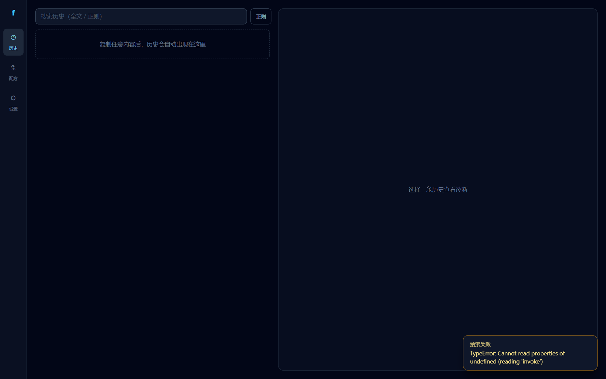
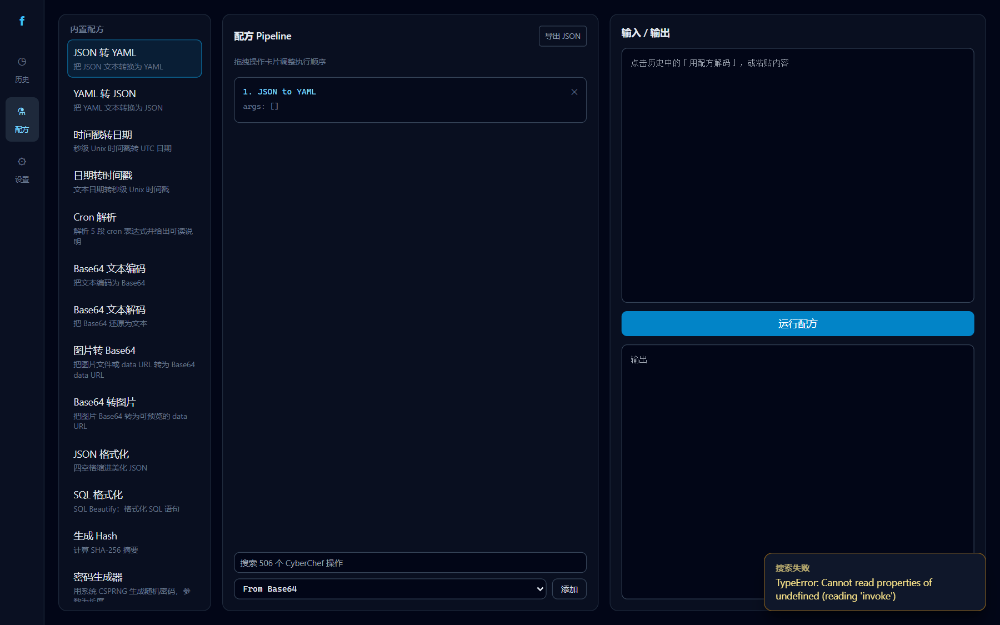
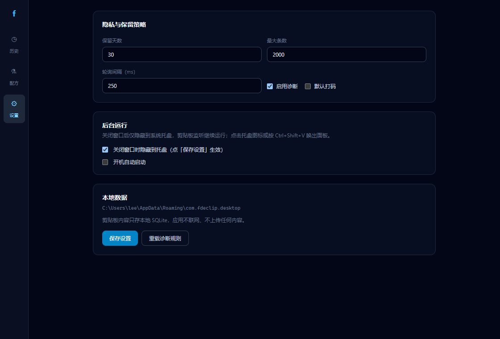

# 【开源推广】fde-clip —— 复制即诊断的离线剪贴板工具箱

**标签**：`开源推广` `Rust` `Tauri` `桌面工具` `隐私`

> 本帖用于开源推广。以下承诺长期有效：
>
> - 项目完整开源，无闭源部分：[github.com/ice-a/fde-clip](https://github.com/ice-a/fde-clip)
> - 采用最宽松的 MIT 许可，任何人可自由使用、修改、分发与再许可
> - 已在项目 README 添加 Linux.do 友链
> - 文中截图均来自真实应用，未做润色
> - 接受社区监督，功能与隐私声明以仓库 README 为准

## 项目地址

| 项目 | 地址 |
| --- | --- |
| GitHub | https://github.com/ice-a/fde-clip |
| 项目主页 | https://ice-a.github.io/fde-clip/ |
| 下载最新版本 | https://github.com/ice-a/fde-clip/releases/latest |
| 开源协议 | [MIT](https://github.com/ice-a/fde-clip/blob/main/LICENSE-MIT) |
| 架构文档 | https://github.com/ice-a/fde-clip/blob/main/docs/ARCHITECTURE.md |

## 快速预览

不想先下载？直接看项目主页的界面预览：

- 主面板与诊断卡：https://raw.githubusercontent.com/ice-a/fde-clip/main/docs/images/dashboard.png
- 配方编辑器：https://raw.githubusercontent.com/ice-a/fde-clip/main/docs/images/recipes.png
- 设置页：https://raw.githubusercontent.com/ice-a/fde-clip/main/docs/images/settings.png







功能预览环境仅为静态截图，不涉及任何在线服务；所有演示数据都来自本机。

## 开发初衷

日常复制粘贴里经常遇到几类痛点：

- 复制了一段 JSON / YAML，不知道语法错在哪
- 收到一段 Base64 / Hex，想快速看看原文
- 看到一串密钥、可疑链接或危险命令，希望能立刻被提醒
- 需要一个简单、离线、不联网、不注册账号的小工具箱，而不是动辄上传内容的在线服务

现有工具要么太重，要么把剪贴板内容送到云端，要么功能散落在多个网站。fde-clip 的目标是：**复制之后，在本机立刻告诉你「这是什么、有没有问题、怎么处理」**，并把高频编解码与格式化工具放在同一个面板里。

## 有什么特别的

1. **诊断在本地同步完成**：20 条 TOML 规则可热加载，典型输入 < 200ms 出结果，不依赖网络。
2. **配方只保留常用工具**：15 个配方覆盖 JSON ↔ YAML、时间戳 ↔ 日期、Cron 解析、Base64 文本与图片编解码、JSON / SQL 格式化、Hash、密码生成、UUID、WebP 图片压缩。配方格式与 CyberChef 兼容，操作库保留 506 个 ops，需要时可扩展。
3. **真正的隐私边界**：没有账号、没有网络请求、没有 AI；剪贴板内容、诊断结果与配方输入输出只写本地 SQLite。
4. **桌面端后台驻留**：系统托盘图标常驻，关闭窗口只隐藏到托盘，剪贴板监听继续；支持全局快捷键与可选开机自启。
5. **Android 不越界**：Android 10+ 禁止后台应用读剪贴板，应用不绕过系统限制；只有用户在系统无障碍设置中主动授权后，后台监听才生效。

## 功能一览

### 剪贴板历史与诊断

- 后台监听文本剪贴板，历史写入本地 SQLite
- 全文 / 正则搜索、置顶、按天数或条数自动过期
- 诊断规则：密钥泄露（OpenAI / AWS / GitHub / 私钥）、JSON 语法错误、危险 shell 命令、可疑 URL、时间戳、编码乱码等
- 高危内容非侵入 toast 提示，诊断卡显示规则、行号与修复建议
- 一键本地打码，不调用网络

### 常用工具配方

- 格式转换：JSON ↔ YAML、JSON / SQL 格式化
- 时间：时间戳 ↔ 日期、Cron 表达式解析
- 编解码：Base64 文本与图片编解码
- 安全与标识：SHA-256 哈希、随机密码生成器、UUID
- 图片：压缩为 WebP
- 配方支持拖拽排序、导出 JSON；大于 10 MB 的文件走 Rust 侧流式处理

### 四平台支持

| 平台 | 产物 | 说明 |
| --- | --- | --- |
| Windows | NSIS / MSI | 托盘后台、全局快捷键、开机自启 |
| macOS | x64 / arm64 dmg | 未签名，需自行信任 |
| Linux | AppImage / deb / rpm | AppImage 包含 WebKitGTK，体积较大 |
| Android | arm64 APK / AAB | 后台监听需用户主动授权无障碍服务 |

## 安装与使用

### 直接下载

从 [Releases](https://github.com/ice-a/fde-clip/releases/latest) 下载对应平台安装包；Android 安装 APK 后，在设置页点击「打开系统无障碍设置」，手动开启「fde-clip 剪贴板监听」即可启用后台嗅探。

### 从源码构建

```bash
pnpm install
pnpm tauri dev        # 桌面开发；首次会自动准备 CyberChef worker bundle
pnpm tauri build      # 桌面安装包
pnpm tauri android build --ci --apk --aab -t aarch64   # Android（需 SDK/NDK）
```

### 常用快捷键

- `Ctrl` + `Shift` + `V`：呼出主面板

## 配置说明

设置页提供以下开关：

| 配置项 | 说明 |
| --- | --- |
| 保留天数 / 最大条数 | 剪贴板历史的自动过期策略 |
| 轮询间隔（ms） | 剪贴板检查频率，默认 250ms |
| 启用诊断 | 关闭后只记录历史，不跑诊断规则 |
| 默认打码 | 复制敏感内容时优先输出打码版本 |
| 关闭窗口时隐藏到托盘 | 桌面端后台运行 |
| 开机自动启动 | 桌面端写入系统启动项 |
| 后台剪贴板监听（Android） | 需用户在系统无障碍设置中主动授权 |

## 更新日志

### v0.1.1（2026-11-26）

- 应用版本统一为 0.1.1，四平台产物由 CI 从同一源码构建
- Android CI 修复：自动发现 NDK 目录、构建后签名 APK/AAB
- 项目主页上线：https://ice-a.github.io/fde-clip/
- README 与 release 说明改为以功能和下载为重点
- 许可统一为 MIT

### v0.1.0（2026-11-25）

- 首个可用版本：剪贴板历史、20 条诊断规则、15 个常用工具配方
- 完整 CyberChef 操作库（506 ops）接入配方编辑器
- 桌面托盘后台、全局快捷键、可选开机自启
- Android 无障碍授权与后台监听
- Windows NSIS / MSI、macOS dmg、Linux AppImage / deb / rpm 出包

## 已知限制

- macOS 产物未签名，首次打开需要手动信任
- Linux AppImage 体积较大（包含 WebKitGTK 运行时）
- Android 后台监听依赖用户授权无障碍服务，这是系统限制，不是应用绕过
- 未实现图片 / 文件历史、WebDAV 同步与多 Provider 等 heavier 功能

## 友链

- Linux.do：https://linux.do/
- 项目主页：https://ice-a.github.io/fde-clip/
- GitHub：https://github.com/ice-a/fde-clip

## 许可

MIT —— 最宽松的开源许可之一：允许任何人使用、复制、修改、合并、发布、分发、再许可和出售本软件，只需保留版权声明。详见 [LICENSE-MIT](LICENSE-MIT)。

欢迎 issue、讨论与 PR。如果这个小工具对你有用，给个 star 就是最好的支持。
