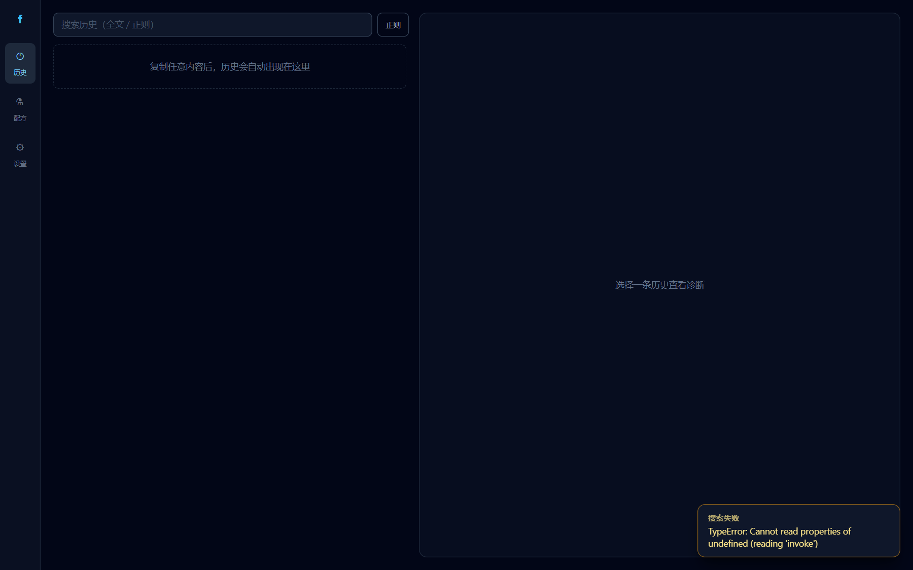
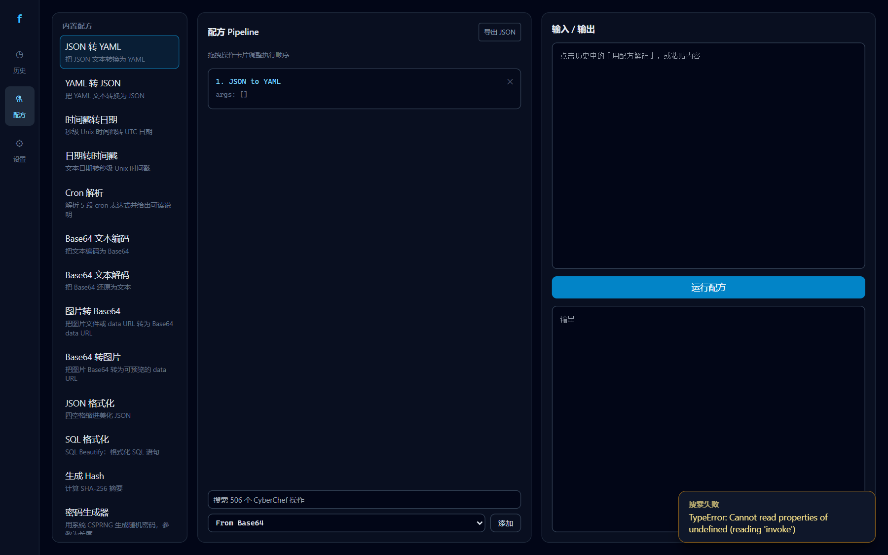

# fde-clip

**离线剪贴板工具箱**——复制即诊断，常用编解码与格式化一键完成。纯本地运行，无账号、无网络请求、无 AI。

[项目主页](https://ice-a.github.io/fde-clip/) · [下载最新版本](https://github.com/ice-a/fde-clip/releases/latest) · [架构说明](docs/ARCHITECTURE.md) · [贡献指南](CONTRIBUTING.md) · [推广文案](PROMOTION.md) · [Linux.do 友链](https://linux.do/)

## 主要功能

### 1. 剪贴板历史与诊断
- 后台监听文本剪贴板，历史写入本地 SQLite，支持全文 / 正则搜索、置顶、自动过期清理
- 复制后本地跑 20 条诊断规则（< 200ms）：密钥泄露（OpenAI / AWS / GitHub / 私钥）、JSON 语法错误、危险 shell 命令、可疑 URL、时间戳、编码乱码等
- 高危内容以非侵入 toast 提示，诊断卡显示规则、行号与修复建议，支持一键本地打码



### 2. 常用工具配方
15 个精简配方，覆盖日常高频操作；支持拖拽排序，可导出 JSON 分享：

| 类别 | 工具 |
| --- | --- |
| 格式转换 | JSON ↔ YAML、JSON / SQL 格式化 |
| 时间 | 时间戳 ↔ 日期、Cron 表达式解析 |
| 编解码 | Base64 文本与图片编解码 |
| 安全与标识 | SHA-256 哈希、随机密码生成器、UUID 生成 |
| 图片 | 图片压缩为 WebP |

配方引擎内置 CyberChef 完整操作库（506 个 ops），可自行组合更多操作。大于 10 MB 的文件走 Rust 侧流式处理。



### 3. 桌面端体验
- 系统托盘常驻；关闭窗口仅隐藏到托盘，剪贴板监听继续运行
- `Ctrl` + `Shift` + `V` 全局快捷键唤出面板
- 可选开机自启（设置页开关，写入系统启动项）
- Windows / macOS / Linux 单仓库构建，CI 自动出包


### 4. Android
- arm64 APK / AAB，由 CI 构建并签名
- Android 10+ 限制后台读取剪贴板：用户可在设置页主动开启无障碍服务，授权后后台嗅探才生效；未授权时仅前台手动使用

## 下载与安装

从 [Releases](https://github.com/ice-a/fde-clip/releases/latest) 获取对应平台产物：

- Windows：`fde-clip_0.1.1_x64-setup.exe` / `fde-clip_0.1.1_x64_en-US.msi`
- macOS：`fde-clip_0.1.1_x64.dmg` / `fde-clip_0.1.1_aarch64.dmg`（未签名）
- Linux：`fde-clip_0.1.1_amd64.AppImage` / `.deb` / `.rpm`
- Android：`fde-clip-arm64.apk` / AAB

自行构建：

```bash
pnpm install
pnpm tauri dev        # 桌面开发；首次会自动准备 CyberChef worker bundle
pnpm tauri build      # 桌面安装包
pnpm tauri android build --ci --apk --aab -t aarch64   # Android
```

## 本地验证

1. 启动应用，复制任意文本，历史流出现新条目并弹出诊断 toast。
2. 复制一段包含 `sk-` 开头假密钥的 JSON，诊断卡标红并显示 `openai_key`。
3. 选中一段 Base64，点「用配方解码」→ 运行「Base64 文本解码」→ 输出原文。
4. 设置页可验证开机自启与「后台运行」开关。

## 隐私

- 剪贴板内容、诊断结果与配方输入输出只写本地 SQLite，不离开设备
- 无网络请求、无账号、无遥测
- 一键打码在前端本地完成

## 许可

[MIT](LICENSE-MIT) —— 最宽松的开源许可之一：允许任何人使用、复制、修改、合并、发布、分发、再许可和出售本软件，只需保留版权声明。

## 开发

架构与实现细节见 [docs/ARCHITECTURE.md](docs/ARCHITECTURE.md)，贡献方式见 [CONTRIBUTING.md](CONTRIBUTING.md)。

## 友链

- [Linux.do](https://linux.do/) —— 技术分享与开源推广社区

