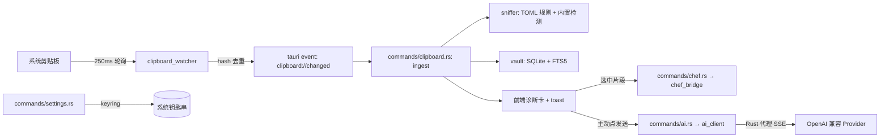

# fde-clip 架构设计（MVP）

## 技术选型与已核实的前提偏差

| 项 | 需求原文 | 实际核实结果 | 采用方案 |
| --- | --- | --- | --- |
| 配方引擎 | `@cyberchef/core`（npm）的 wasm | npm 上无此包（404）。官方包为 `cyberchef@11.6.0`，提供 506 个 operations，核心入口 `src/core/Chef.mjs` | 前端 Module Worker 中 `Chef.bake()` 执行原生配方 JSON；Vite 需 alias / wasm / Node polyfill / UMD 补丁适配其 Webpack-only 代码。Rust `chef_bridge` 保留基础 ops 与 >10MB 流式处理 |
| 剪贴板变化 | `tauri-plugin-clipboard-manager` 监听 | v2.5.0 只提供 `read_text`/`write_text` 等读写 API，无变化事件 | `clipboard_watcher` 在独立线程 250ms 轮询 + 内容哈希去重；`read_text` **禁止在主线程调用**（Linux 会死锁） |
| Tauri 版本 | v2 | 稳定版 2.12.7；clipboard-manager 2.5.0；keyring 3.6.3；rusqlite 0.43.0 | 全部锁定到上述稳定版 |

## 模块图

## 数据流

1. watcher 线程读到新文本 → 计算 FNV-1a 64 位哈希 → 与上次不同则 emit `clipboard://changed`。
2. 前端监听事件 → `invoke("clipboard_ingest", { text })` → Rust 侧 sniffer 诊断（同步，目标 < 200ms）+ vault 落库 → 返回带诊断的记录。
3. 前端更新 Zustand 历史流；`critical`/`warning` 级别弹非侵入 toast。
4. 配方编辑器：20 个内置配方 → Worker 消息 → `Chef.bake()`（506 ops） → 输出回填；>10MB 大文件走 `chef_stream_file` 分块处理。
5. AI 抽屉：只有用户主动发送才构造请求；baseURL/key/model 从设置读；key 从 keyring 读；Rust 侧 reqwest 流式解析 SSE，逐 chunk emit `ai://chunk`，前端追加渲染。

## 线程模型

- **主线程**：Tauri 事件循环、窗口、托盘；不读剪贴板。
- **watcher 线程**：独立 `std::thread`，250ms 轮询，仅持 `AppHandle` 与上次哈希。
- **命令线程**：Tauri 默认线程池执行 `invoke`；SQLite 连接用 `Mutex<Connection>` 串行化（MVP 写负载极低）。
- **AI 请求**：`async` 命令在 tokio 运行时执行，SSE 解析用 `bytes_stream` 逐块。

## 剪贴板监听策略

- 轮询间隔 250ms（可通过设置调整）；只处理文本，图片/文件在后续阶段接 `read_image`。
- 自复制去重：写入后记录哈希，避免自己的 `write_text` 回环。
- 内容hash 用标准库 `DefaultHasher`，无额外依赖；不保存原始哈希与内容之外的元数据到云端。

## 隐私边界

- 所有剪贴板内容与诊断结果只写本地 SQLite（`app_data_dir/vault.db`）。
- API Key 只存系统钥匙串（Windows Credential Manager / macOS Keychain / Linux Secret Service），不明文落盘、不进入诊断流水线。
- 只有点击「发送给 AI」才发送选中片段 + 场景 prompt；无后台自动上传。
- 一键打码在前端本地执行正则替换，不调用网络。

## 性能预算与实现取舍

| 指标 | 预算 | MVP 措施 |
| --- | --- | --- |
| 常驻内存 | < 150MB | 不引入 Electron；watcher 单线程；Vite 前端无重型 UI 库 |
| 冷启动 | < 1.5s | SQLite 延迟初始化；规则编译一次；不做预热扫描 |
| 诊断延迟 | < 200ms | 规则为预编译 `regex::RegexSet`；同步执行，无网络调用 |
| 包体积 | < 25MB | 完整 CyberChef 的 `OpModules` chunk 约 21.9MB（未压缩），Rust release 剥离符号；release 安装包体积待实测 |

## 当前范围

包含：20 条 TOML 诊断规则（热加载）、SQLite FTS5 历史、20 个内置 CyberChef 配方、506 个 operations 的操作库、OpenAI 兼容流式 Provider、托盘与全局快捷键。

不包含：图片/文件历史、WebDAV 同步、多 Provider 管理 UI、macOS 签名配置。

已验证：生产 bundle 中 Base64、Hex、MD5、时间戳、Magic、JWT Decode、Fork、JSON Beautify 配方均在 Worker 中执行成功并产出正确结果。

适配点：`vite.config.ts` 中的 UMD 补丁（chi-squared `with`、zlibjs 模块作用域、GOST 导入重赋值、node-md6 隐式全局、codepage ESM 导出、lzma 动态 require）、Node polyfill、`__dirname`/`__filename` define、`optimizeDeps.exclude`；Worker 提供 CyberChef 协议钩子（`sendStatusMessage`/`sendProgressMessage`/`setOption`/`loadRequiredModules`）。

已知限制：dev 模式通过 `predev` 脚本复用已验证的生产 CyberChef worker bundle（`dev-cyberchef/`，由 Vite 中间件提供），避开了 esbuild 对 500+ 模块的逐包预构建；首次启动会自动执行一次 `pnpm build`。LZMA 相关 op 使用简化初始化，功能未完整验证。
